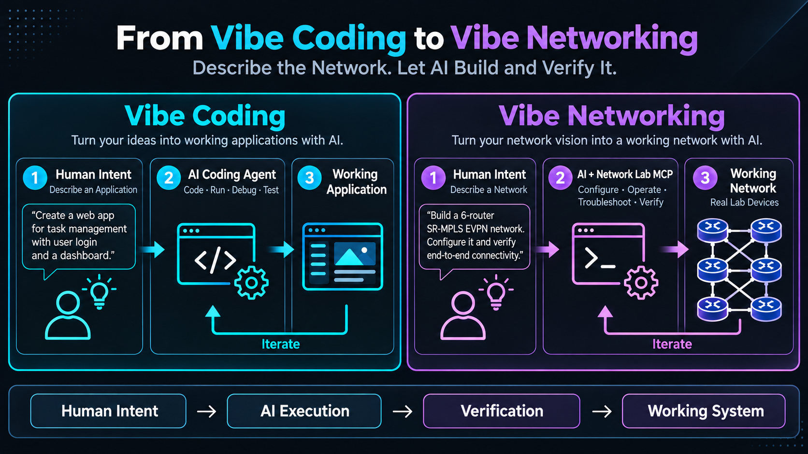
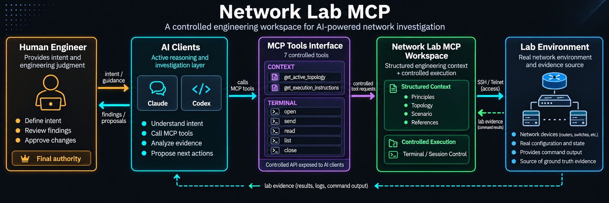
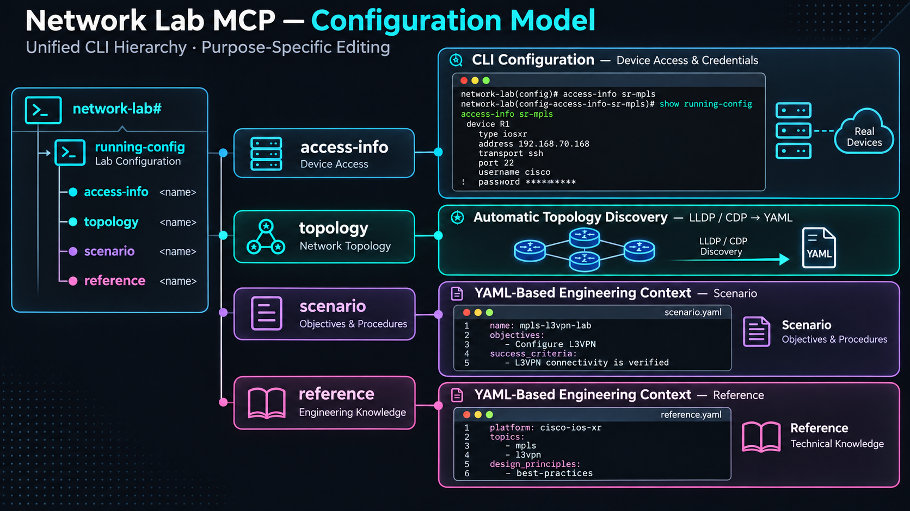

# Network Lab MCP

**An AI Network Engineer Workspace for real network labs.**

**Describe the network. Let AI investigate, build, troubleshoot, and verify it — while you remain in control.**

Network Lab MCP connects an MCP-capable AI client to real network lab devices through a small, controlled tool interface. It supplies the AI with explicit engineering context and observable terminal sessions, so the AI can follow evidence, run commands, and work through complex lab investigations instead of relying on a rigid test script.

**The AI client does the reasoning; Network Lab MCP provides the context and access; the engineer retains authority over decisions and committed definitions.**

<p align="center">
  
</p>

[Watch the demo](https://youtu.be/ILkW7yuU1Y4) · [Why it exists](#why-network-lab-mcp) · [How it works](#how-it-works) · [Configuration model](#configuration-model) · [Quick Start](#quick-start) · [SSH jump servers](#ssh-jump-server-support) · [Documentation](#documentation)

## Why Network Lab MCP?

As a network engineer, I often want to investigate or validate something in a lab, but customer work, troubleshooting, meetings, and documentation limit the time available for hands-on verification.

What if AI could do the time-consuming investigation — inspect the topology, connect to the right devices, compare outputs, follow a problem, and return evidence — without taking away the engineer's visibility or judgment?

That is the motivation behind Network Lab MCP: **delegate the investigation, not the engineering responsibility.**

The project explores a concept I call **Vibe Networking**, inspired by Vibe Coding: express the network objective in natural language, let an AI agent plan and execute work in a real lab, inspect what actually happened, and iterate. It is a direction for AI-assisted engineering, **not a claim of unrestricted or fully autonomous production-network operation**.

Network Lab MCP provides a lightweight **AI network engineer layer** for lab environments, designed to make the most of an AI client's reasoning capabilities while retaining observable, controlled device access.

## What you can do

- **Investigate and troubleshoot:** inspect live device state across a lab, correlate observations, and collect command evidence.
- **Discover and validate topology:** collect LLDP/CDP neighbors, review a topology candidate, and explicitly commit the definition.
- **Build and verify lab services:** give the AI engineering objectives and let it use real terminals to configure and test lab devices, subject to the AI client's permissions and human oversight.
- **Validate resilience and traffic:** observe planned failures, traffic behavior, protocol convergence, and service continuity using available lab instruments and evidence.
- **Reuse engineering knowledge:** guide repeated work with Scenarios and References rather than repeating every instruction from scratch.
- **Watch AI activity:** monitor terminal output live and inspect session transcripts instead of treating the AI as a black box.
- **Work from your local workstation:** use SSH ProxyJump for SSH devices and SSH local port forwarding for legacy Telnet-only devices, without running Network Lab MCP on the jump server.

Network Lab MCP is **not** a network-engineering reasoning model, a fixed test-script library, or a production network automation platform. An external AI client supplies the reasoning and decides which tool or command to use next.

## How it works

<p align="center">
  
</p>

1. **Human intent:** an engineer specifies the goal and the limits of the task.
2. **Engineering context:** Network Lab MCP exposes the selected topology, task instructions, principles, and applicable references — without revealing private access credentials.
3. **AI reasoning:** the AI client chooses the investigation steps and invokes MCP tools.
4. **Controlled execution:** Network Lab MCP connects to devices through managed SSH/Telnet terminal sessions, using private connection information internally.
5. **Evidence and review:** the AI analyzes device outputs and reports findings; the engineer can observe terminals and approves changes to managed definitions through the human CLI.

> **Safety boundary:** the candidate/commit model protects Network Lab MCP's *managed lab definitions and selections*. It does **not** automatically make device CLI commands read-only or require human approval before every command sent by an AI client. Configure client permissions and use an isolated lab accordingly.

### Built on Proven Tools

Network Lab MCP follows a lightweight, composable design: **reuse established tools for network connectivity and terminal management, and build the AI-oriented engineering layer on top**. Rather than implementing its own SSH or Telnet stack or terminal-session manager, it orchestrates **OpenSSH**, **tmux**, and a local **Telnet client** where legacy access is required.

OpenSSH handles SSH transport and authentication; tmux provides persistent, observable terminal sessions; and Telnet supports legacy lab devices. Network Lab MCP adds logical device resolution, private connection handling, session lifecycle and safety checks, topology discovery, and reusable engineering context. The AI client supplies reasoning; the engineer retains operational judgment and control.

This approach avoids reinventing mature protocols, but still requires careful integration around SSH host keys, jump-hop behavior, terminal ownership, and failure handling. See [Connection architecture](docs/connection_architecture.md) for the internal design and trade-offs.

### A deliberately small MCP interface

Network Lab MCP exposes exactly **seven MCP tools**:

| Tool | Purpose |
|---|---|
| `get_active_topology` | Read the currently selected logical topology |
| `get_execution_instructions` | Read selected task guidance and engineering context |
| `terminal_open` | Open a managed terminal by logical device ID |
| `terminal_send` | Send text to a managed device terminal |
| `terminal_read` | Read its output |
| `terminal_list` | Inspect managed terminal sessions |
| `terminal_close` | Close a managed terminal session |

The AI uses logical device names; it does not obtain private `access-info`. See the [MCP tool contract](docs/mcp_tools.md).

## Configuration Model

Network Lab MCP separates **what is selected**, **how to connect**, **what exists**, **what to accomplish**, and **what knowledge to reuse**.

<p align="center">
  
</p>

*Conceptual diagram: the running configuration selects definitions; it does not contain every definition's full content. The illustration's masked password is not a representation of local CLI password display behavior.*

| Component | Responsibility | AI visibility |
|---|---|---|
| `running-config` | Selects the active access-info, topology, scenario, and references | Indirect |
| `access-info` | Private management endpoints and authentication details | **Not exposed through MCP** |
| `topology` | Logical devices, interfaces, and connectivity | Yes |
| `scenario` | Objectives, task procedures, and verification criteria | Yes |
| `reference` | Reusable technical knowledge and operational guidance | Yes, when selected or inspected read-only |

`running-config` is a **selection model**, not the storage location for all definitions. Creating or changing a topology, Scenario, or Reference does not automatically select it. Selection changes become active after an explicit CLI `commit`.

**Scenario** describes *what the AI is trying to accomplish now*. **Reference** contains *knowledge that can help across many tasks*, such as SR-MPLS or EVPN guidance, platform-specific notes, or test-equipment procedures. **Principles** are separate, always-applied rules, not a substitute for task-specific scenarios or reusable references.

The AI may inspect a catalog of stored Scenarios and References, use the applicable knowledge, and propose new or refined definitions. It does not directly commit those definition changes. Engineers edit and commit them through the independent human CLI.

### Three complementary configuration workflows

- **CLI configuration:** use the IOS XR-style human CLI to manage access information, definitions, and active selections with candidate/commit behavior. `clear` discards uncommitted changes.
- **Topology discovery:** discover LLDP/CDP neighbor relationships from actual devices and review the resulting candidate before a separate definition commit and active selection.
- **YAML-based engineering context:** edit Topology, Scenario, and Reference definitions through the configured external editor (`$VISUAL`, then `$EDITOR`, then Vim). Access-info uses the structured CLI.

New installations start with the fictional `sample_lab` access-info and topology, the onboarding `getting_started` Scenario, and the supporting `cisco_platform_guidance` Reference. Existing local selections are not automatically rewritten.

See [Architecture](docs/architecture.md), [CLI reference](docs/cli_reference.md), and [Scenario / Reference format](docs/scenario_format.md).

## Demo

### Traffic Loss Validation with Network Lab MCP

The [video demonstration](https://youtu.be/ILkW7yuU1Y4) illustrates an AI-assisted workflow involving live terminal observation, a validation Scenario, traffic measurement, analysis, and reporting.

The demo is a concrete lab example, not a guarantee that every device, test instrument, or network design can be controlled without additional configuration.

## Quick Start

Choose your platform:

- [macOS — step-by-step installation](#macos-installation)
- [Linux — installation](#linux-installation)
- [Register with Claude Code or Codex](#register-the-mcp-server)
- [First connection and troubleshooting](#first-use-and-troubleshooting)

Network Lab MCP currently uses a **local editable installation**. Keep the repository checkout: its local `lab/` directory is part of the operational model. A non-editable wheel/package-index install is not the supported deployment model.

### macOS installation

The following steps are designed for engineers who are familiar with network CLI tools but may be new to Python virtual environments, MCP, or Claude Code. Run the shell commands in **macOS Terminal**, not inside the `network-lab#` CLI.

**Requirements**

| Component | Why it is needed |
|---|---|
| macOS | Local workstation running Network Lab MCP |
| Python 3.10+ | Network Lab MCP runtime; a supported Python 3.13 environment was used during validation |
| Git | Clone the source repository |
| `tmux` | Managed terminal sessions and observable command output |
| OpenSSH client (`ssh`) | Direct SSH, ProxyJump, and SSH tunnels |
| Vim (`vim`) | Default editor for Topology, Scenario, and Reference definitions; normally included with macOS |
| Claude Code | AI client used in the macOS E2E validation; install and sign in separately |
| `telnet` client | **Only** for direct Telnet or legacy Telnet-only devices via an SSH tunnel |

Homebrew is a convenient way to install missing prerequisites; it is not itself part of Network Lab MCP. See [brew.sh](https://brew.sh/) for installation instructions. See the [Claude Code setup guide](https://docs.anthropic.com/en/docs/claude-code/setup) for its supported installation procedure.

**Step 1 — Inspect what is already installed**

```bash
uname -s                     # Expected: Darwin
python3 --version            # Must be Python 3.10 or newer
command -v git
command -v tmux
command -v ssh
command -v claude
```

If any command is missing, install that dependency first. If Homebrew is available, a typical setup for Git, Python, and tmux is:

```bash
brew install git python tmux
```

OpenSSH is normally available on macOS; check `command -v ssh` rather than assuming a particular installation path. Install Claude Code separately using its official instructions. Do not expect `pip install -e .` to install Claude Code, tmux, OpenSSH, or Telnet.

**Text editor:** Network Lab MCP uses `$VISUAL`, then `$EDITOR`, then `vim` for its `edit` command. Vim is normally included with macOS, so additional installation is usually unnecessary. Check with `command -v vim`; if you prefer another editor, set `VISUAL` or `EDITOR` in the environment that launches the Network Lab CLI. Access-info remains editable through structured CLI commands rather than the external editor.

For a Telnet-only lab device, **also** check:

```bash
command -v telnet
telnet --help    # Option syntax varies by client; consult its own help/man page
```

Some macOS installations do not include a Telnet client. Install a compatible client using a trusted package source if needed. **Before using Telnet over SSH**, confirm that the installed client supports the options required by your Network Lab MCP version (including `-K` and `-E` where used by the implementation). Package names, executable locations, and supported options vary; do not assume that `/usr/local/bin/telnet` exists on every Mac. If you only need SSH devices, Telnet is optional.

**Step 2 — Clone the project**

```bash
cd ~
git clone https://github.com/CiscoDevNet/network-lab-mcp-community.git
cd network-lab-mcp
```

You may choose a different directory. Keep a note of its **absolute path**; the MCP registration will use it. The example below uses `~/network-lab-mcp` only because the clone command above creates that directory.

**Step 3 — Create the Python environment and install**

```bash
python3 -m venv .venv
source .venv/bin/activate
python -m pip install -e .
```

The `(.venv)` shell prefix is a useful indication that the virtual environment is active. A venv keeps Network Lab MCP's Python dependencies separate from other projects. Every new Terminal window used for `./run_cli.sh` should activate this venv first, or use its Python executable explicitly.

**Step 4 — Check the installation**

```bash
python --version
python -m pip show network-lab-mcp
test -x .venv/bin/network-lab-mcp && echo 'MCP executable found'
command -v tmux
```

If a Python environment was upgraded or moved, recreate the virtual environment and register the new executable path as needed. Do not move the repository after registering the MCP server without updating Claude Code's command path.

**Step 5 — Initialize the local running configuration**

```bash
if [ ! -e lab/settings.yaml ]; then
  cp lab/settings.example.yaml lab/settings.yaml
fi
```

This deliberately **does not overwrite** an existing `lab/settings.yaml`. The checked-in `sample_lab` definitions use fictional documentation addresses: they let you inspect the configuration model but are **not real reachable devices**. Real lab access requires a private access-info definition and matching logical device IDs in the selected topology.

**Step 6 — Start the human CLI**

```bash
./run_cli.sh
```

Then type commands **inside** the Network Lab CLI:

```text
network-lab# help
network-lab# show version
network-lab# show running-config
network-lab# configure
network-lab(config)# show running-config
```

`./run_cli.sh` launches the **human configuration CLI**, not the MCP stdio server. A working CLI does not, by itself, prove that a real network device can be reached. Do not share `show running-config` from an access-info definition: it can display real passwords in plaintext.

**Step 7 — Register and verify the MCP server**

Follow [Register the MCP server](#register-the-mcp-server). **User scope is recommended for personal macOS installation**, because Claude Code often runs from a working directory other than the Network Lab MCP source tree.

**Step 8 — Test from a separate working directory**

```bash
mkdir -p ~/network-lab-workspace
cd ~/network-lab-workspace
claude
```

Inside Claude Code, use `/mcp` and confirm that `network-lab` is connected. Start with a safe request, such as **“Use Network Lab MCP to show the active topology; do not connect to devices or change any configuration.”** After configuring a permitted lab, proceed to read-only device commands.

### Linux installation

Linux remains supported. Install Python 3.10+, Git, tmux, and OpenSSH through your distribution's package manager. Install Telnet only if your lab requires it. The example below is for a Debian/Ubuntu-style system:

```bash
sudo apt-get update
sudo apt-get install -y git python3 python3-venv python3-pip tmux openssh-client

git clone https://github.com/CiscoDevNet/network-lab-mcp-community.git
cd network-lab-mcp
python3 -m venv .venv
source .venv/bin/activate
python -m pip install -e .

if [ ! -e lab/settings.yaml ]; then
  cp lab/settings.example.yaml lab/settings.yaml
fi

./run_cli.sh
```

Use the registration instructions below for your AI client. The newly added macOS SSH jump-server workflows have not been revalidated end-to-end on every Linux environment.

### Register the MCP server

For a **local stdio MCP server**, register the absolute path to `.venv/bin/network-lab-mcp`. **Do not register `run_cli.sh`**: it is the interactive human CLI, not the MCP server entry point.

**Claude Code — recommended user scope**

From the Network Lab MCP repository directory:

```bash
# Run from the repository checkout, after creating .venv.
claude mcp add --scope user network-lab -- \
  "$(pwd)/.venv/bin/network-lab-mcp"

claude mcp list
```

Expected result (the path varies):

```text
network-lab: /absolute/path/to/network-lab-mcp/.venv/bin/network-lab-mcp - ✔ Connected
```

`--scope user` makes this MCP registration available to Claude Code across your working directories. A **project/local-scoped** registration can work in the repository directory yet be invisible from another workspace — a common source of confusion. Do not register another entry blindly if one with the same name already exists; first inspect its scope and executable path. An unrelated MCP server reporting `Failed to connect` does not necessarily prevent `network-lab` from connecting.

Restart an already-running Claude Code session after changing MCP configuration; changes may not appear in the current session. In Claude Code, use `/mcp` to confirm the server is loaded. The seven Network Lab MCP tools should then be available to the AI client.

**Codex CLI**

```bash
codex mcp add network-lab -- \
  /absolute/path/to/network-lab-mcp/.venv/bin/network-lab-mcp
codex mcp list
```

For a local stdio server, Codex may show `Auth: Unsupported`; device authentication is handled privately by Network Lab MCP, not by MCP authentication. In the tested Codex environment, the following server setting was also needed in `~/.codex/config.toml`:

```toml
[mcp_servers.network-lab]
command = "/absolute/path/to/network-lab-mcp/.venv/bin/network-lab-mcp"
default_tools_approval_mode = "approve"
```

Restart Codex after changing its configuration. AI-client configuration and approval options may differ by client version.

### First use and troubleshooting

**Separate the three layers when diagnosing a problem:**

1. **Installation:** can the human CLI start with `./run_cli.sh`?
2. **MCP registration:** does `claude mcp list` show `network-lab ... ✔ Connected`, and does `/mcp` show it in the current Claude Code session?
3. **Device access:** are the correct *active* access-info and topology selected, and can the allowed device actually be reached?

| Symptom | Check / resolution |
|---|---|
| `python3` is too old or virtual environment fails | Install a supported Python 3.10+ interpreter, recreate `.venv`, and reinstall. |
| `tmux` not found | Install tmux, verify `command -v tmux`, then restart the CLI/MCP client as appropriate. |
| `telnet client not found` | Install a compatible local Telnet client and verify the supported options; SSH-only use does not require it. |
| `network-lab-mcp` executable missing | Activate the correct venv and run `python -m pip install -e .` in the checkout. |
| `network-lab` missing from `claude mcp list` | Register at **user scope** with the absolute executable path; verify the active Claude Code configuration. |
| Works from the source checkout but not another directory | The server was likely registered in project/local scope. Check its scope; user scope is normally preferable for workstation use. |
| `network-lab ... Failed to connect` | Check that the executable exists, the venv is intact, and the registration points to the current checkout. Avoid printing environment variables containing secrets. |
| `/mcp` does not show a newly added server | Start a new Claude Code session after updating registration. |
| `Device 'Router1' is not present in access-info` | The active topology and active access-info have different device inventories. Add an authorized connection definition or select the intended definitions **in the human CLI**; never guess credentials. |
| Discovery connects but produces zero managed links | Check whether observed neighbors are actually registered as managed devices. Unresolved LLDP/CDP neighbors do not become guessed topology links. |
| Jump-host password prompt is rejected | Check the running version, private access-info selection, prompt/host identity, and authentication configuration. Do not disable fail-closed checks to force access. |
| Host key verification failed | A first-use key is registered automatically, so this means the key of the jump server or target **changed** (or is of another type than the registered one) or could not be registered (`TOFU_*` error). Verify the new key through a trusted channel, then review the replacement with `discover topology` from an interactive terminal (a key in your own `~/.ssh/known_hosts`: `ssh-keygen -R`). Managed terminals never replace keys. **Never use `StrictHostKeyChecking=no` as a workaround.** |

**Important: topology and access-info are independently selected.** A topology can contain `Router2` while the selected access-info only contains `Router1` and `LegacyRouter`. In that case, opening `Router2` must fail rather than discovering or guessing its credentials. Discovery can create a topology *definition* without automatically making it the active topology. The second selection/commit step matters; see the example below.

**First safe AI request:**

> Use Network Lab MCP to inspect the currently active topology and execution instructions. Report the logical device inventory. Do not open terminal sessions or make changes.

**First authorized read-only device request:**

> Use Network Lab MCP tools only. Open a managed terminal to `Router1`, run `show version`, read the response, and close only the session you created. Do not execute configuration commands or reveal credentials.

> **Permissions:** keep the AI client's normal approval controls enabled, particularly for device configuration and destructive operations. Bypass/never-ask modes are appropriate only when explicitly chosen for a fully controlled, isolated lab; they bypass client-side confirmation and are not prerequisites for using Network Lab MCP.

## SSH Jump Server Support

Network Lab MCP can access **both modern SSH-enabled network devices and legacy Telnet-only devices through an SSH jump server**, directly from a local workstation. The two transport methods are deliberately distinct:

| Target device | Connection method | Local requirement | Jump-server requirement |
|---|---|---|---|
| SSH-enabled router | **OpenSSH ProxyJump** | OpenSSH | SSH server and reachability to target SSH |
| Legacy Telnet-only device | **SSH local port forwarding + local Telnet client** | OpenSSH **and** Telnet client | SSH server and reachability to target Telnet port |

**No Network Lab MCP installation and no Telnet client are required on the jump server.** Network Lab MCP runs on the local workstation; it selects the connection method from the private Access-info definition. A single Access-info can describe both kinds of devices.

```text
Local macOS workstation
  Claude Code ── MCP ── Network Lab MCP
                           |
                           +── SSH ProxyJump ──────> jump1 ── SSH ──> Router1
                           |
                           +── SSH -L 127.0.0.1 ──> jump1 ── Telnet ──> LegacyRouter
                               + local telnet client
```

The second path is **not** SSH ProxyJump to a Telnet device. It uses SSH local port forwarding (a tunnel between the workstation and the jump server), followed by Telnet over the jump server's network path to the legacy device. The Mac's local forwarded port binds to `127.0.0.1`, not a public interface.

### Example private Access-info

The following is **illustrative only**, with RFC 5737 documentation addresses and no real credentials. Use the human CLI to create a private Access-info definition; actual authentication fields remain local and must never be committed to a public repository.

```text
access-info example_lab
 jump-host jump1
  type host
  address 192.0.2.10
  transport ssh
  port 22
  username jumpuser
 !
 device Router1
  type iosxr
  address 192.0.2.20
  transport ssh
  port 22
  username labuser
  jump-host jump1
 !
 device LegacyRouter
  type ios
  address 192.0.2.30
  transport telnet
  port 23
  username labuser
  jump-host jump1
 !
```

Add the credentials through the private configuration workflow when needed. This example is not a claim that those documentation-only addresses are reachable. The active topology must also use the exact logical device IDs `Router1` and `LegacyRouter` for AI terminal access.

### SSH host keys: lab TOFU (trust on first use)

You do not type anything for a new device. The first time an SSH hop (the device and, for ProxyJump, the jump server) is used and **no known_hosts file has an entry for it**, Network Lab MCP registers its host key automatically, for `discover topology` and for managed terminals alike:

1. An authentication-free OpenSSH probe (dummy user `nlm-hostkey-probe`, no password, no key, no multiplexing, a temporary known_hosts) records the key the device presents.
2. The key is saved in the **product's own known_hosts** (macOS `~/Library/Application Support/Network Lab MCP/ssh/known_hosts`, Linux `~/.local/state/network-lab-mcp/ssh/known_hosts`) and read back, **before any credential is sent**.
3. The real connection then runs with `StrictHostKeyChecking=yes` on every hop. Your own `~/.ssh/known_hosts` is read but never modified.

The CLI prints `SSH host key automatically accepted (TOFU):` with the device, hop and SHA256 fingerprint; every registration is also logged to `logs/hostkey-tofu.log`.

- **Already registered (any known_hosts):** nothing is probed, nothing is asked.
- **Changed key, or a different key type than the registered one:** the connection is refused before any credential is sent. A key is **never** replaced automatically and MCP/managed terminals cannot replace it. In an interactive terminal, `discover topology` offers a review: it shows the old and new fingerprints and asks `Replace the trusted host key? [yes/no] (default: no):` on the controlling terminal. A key that lives in your own `~/.ssh/known_hosts` is never edited; the CLI prints the `ssh-keygen -R` command for you to run.
- **TOFU limit:** the first key cannot be verified independently; someone in the middle of the *first* connection would be trusted. Register keys manually if your lab network is not trusted.
- **Effect on the device:** the probe is one failed-looking login for a user that does not exist. Some devices count that, ask AAA, or block the source address. That has **not been tested on real equipment**; if a device cannot be probed, register its key once with a manual `ssh`.
- Details: [SECURITY.md](SECURITY.md) (section 11a) and [docs/cli_reference.md](docs/cli_reference.md).

### Validation and security status

On **November 2, 2026**, macOS real-lab E2E checks succeeded for an SSH-enabled IOS XR device and a legacy Telnet-only IOS device, both through an SSH jump server: managed terminal open, authentication, read-only `show` commands, response retrieval, simultaneous sessions, independent closure, and final cleanup. Discovery also connected through both methods and collected LLDP/CDP observations. This is **specific observed coverage**, not a claim that all macOS/Telnet/OpenSSH combinations, unexpected disconnects, or restart/fault conditions have been tested.

- The **local workstation ↔ jump server** SSH connection is encrypted.
- The **jump server ↔ legacy Telnet-only device** path carries **unencrypted Telnet** traffic; use only an authorized, protected lab/management network and account for this risk.
- Local port forwarding through `127.0.0.1` is not a process-level access-control boundary.
- Private device and jump-server passwords are resolved internally; they must not be put in AI prompts, published logs, or repository examples.
- SSH host-key verification must remain enabled. First-use keys are registered automatically (TOFU, see above); a changed or other-type key is refused and can only be replaced by a human in the CLI.

**Lab TOFU, validated on macOS in a real lab:** Topology Discovery through an SSH jump server reached 9 of 9 devices (including a Telnet-only device) with 7 first-use host keys registered automatically (ED25519, RSA and ECDSA) and no manual key input; a second run needed no new registration and gave the same results. In short: no manual host-key approval on first use, already-known hosts are not registered again, and a changed registered key is refused (replacement only by a human in the CLI). Details: [CHANGELOG](CHANGELOG.md) and [SECURITY.md](SECURITY.md) section 11a.

**Not yet validated:** the jump server's own first-use registration, refusal and CLI re-registration of a changed real-device key, effects of the authentication-free probe on AAA (failed-login counters, TACACS+/RADIUS, `login block-for`, source blocking), Linux, legacy SSH algorithms on real devices, and all SSH authentication methods and failure patterns. Additional verification is needed before relying on them.

## Example: discovering and selecting a topology

First, create a private access-info definition and select it as active through the human CLI. For example, you can start by copying the fictional template and changing it locally:

```bash
cp lab/access-info/sample_lab.yaml lab/access-info/my_lab.yaml
```

With `my_lab` already selected as the active access-info, a typical CLI flow is:

```text
network-lab# configure
network-lab(config)# discover topology
Discovering topology from access-info 'my_lab'...
...
Discovery complete.
...
network-lab(config-topology-my_lab)# show configuration
...
network-lab(config-topology-my_lab)# commit
Commit complete.
network-lab(config-topology-my_lab)# root
network-lab(config)# running-config
network-lab(config-running)# topology my_lab
network-lab(config-running)# commit
Commit complete.
```

The two commits serve different purposes: **the first saves the discovered topology definition; the second selects it as active**.

Discovery is intentionally conservative:

- `discover topology` collects LLDP/CDP evidence only; `discover topology l3` adds observed IPv4/VRF information.
- It **rebuilds** the topology candidate from the current observations instead of silently merging older links. Unobserved elements can therefore disappear **from the new candidate**. The committed definition remains untouched until `commit`.
- Missing or conflicting evidence, failures, and uncommitted manual edits cause Discovery to fail closed rather than guessing or overwriting edits.
- Discovery does not configure devices, enable LLDP/CDP, auto-commit, or auto-select a topology.
- `clear` discards uncommitted candidate changes and restores the committed state.

See [CLI reference](docs/cli_reference.md) for detailed discovery conditions and command syntax.

After the context is selected, a typical AI sequence uses:

```text
get_active_topology()
get_execution_instructions()
terminal_open(...)
terminal_send(...)
terminal_read(...)
...
```

## Observable terminals

Engineers can observe the same managed terminal activity used by the AI, read-only, from the human CLI:

```text
network-lab# terminal monitor R1
RP/0/RP0/CPU0:R1#show version
...
RP/0/RP0/CPU0:R1#
```

Monitoring does not inject commands into the observed session. It can follow managed and Discovery terminal sessions, including their lifecycle changes. Exit locally with `q`.

Terminal transcripts are stored at `logs/terminal/<device-id>/*.log`. They are **raw transcripts**, not guaranteed-redacted records; handle them as sensitive data. See [Terminal monitor](docs/cli_reference.md#terminal-monitor).

## Platform-aware engineering knowledge

The architecture is **vendor-neutral**, but the public examples and initial platform guidance focus on Cisco devices. The included `cisco_platform_guidance` Reference illustrates how reusable knowledge can be qualified by device family, software release, feature, and question type. It is selected by the sample configuration, not mandatory for all installations, and it does not fetch or validate documentation automatically.

Protocol theory may transfer across platforms, but command syntax, supported features, limitations, telemetry paths, and release-specific behavior require device-appropriate evidence. For example, telemetry paths should come from applicable YANG models, not guesses; the [Cisco YANG models repository](https://github.com/YangModels/yang/tree/main/vendor/cisco) is one possible reference source.

### Supported device types

| `device.type` | Platform | Topology Discovery |
|---|---|---|
| `iosxr` | Cisco IOS XR | LLDP + CDP |
| `iosxe` | Cisco IOS XE | LLDP + CDP |
| `ios` | Classic Cisco IOS | CDP |
| `nxos` | Cisco NX-OS | Not currently supported |
| `host` | Generic host / endpoint | Skipped |

A registered type does not imply that every platform capability, command, or discovery protocol is supported.

## Security and operational boundaries

See [SECURITY.md](SECURITY.md) for the complete trust model and vulnerability reporting guidance.

- **Private credentials:** no MCP tool exposes `access-info`. Terminal connections resolve credentials internally from the selected private definition.
- **Local CLI visibility:** `show configuration` and `show running-config` can display access-info passwords **in plaintext** for human lab use. Do not share that output.
- **Raw device output:** terminal results and logs are not universal secret-redaction mechanisms. Remote device echoes and output can contain sensitive information.
- **SSH/Telnet:** SSH key/agent and password authentication are supported; classic IOS-style Telnet authentication is lab-only because Telnet is unencrypted over the target leg.
- **Jump hosts:** one SSH jump hop is supported; ProxyJump is for SSH targets, while Telnet targets use SSH local port forwarding. Multi-hop chains are not supported.
- **Change control:** candidate/commit applies to local definition editing. Sending a configuration command to a real device through a terminal is a separate operation governed by the AI client's permissions and your lab procedures.
- **Repository hygiene:** `.gitignore` excludes common local operational data but is not a substitute for reviewing every change before publishing.

## Current limitations

- Discovery supports IOS XR, IOS XE, and classic IOS, but not NX-OS.
- No SNMP, NETCONF, RESTCONF, or generic discovery-plugin framework.
- No automatic stale-link pruning **outside a Discovery run**; Discovery itself rebuilds the candidate from current observations.
- L3 enrichment records directly observed IPv4 address and VRF information, not an inferred routed topology.
- Editable checkout required; no standard non-editable/wheel installation.
- `access-info` is edited through structured CLI commands, not the external YAML editor.
- SSH jump-server support is limited to one hop; Telnet-through-jump requires a compatible local Telnet client.
- Host keys of unregistered hops are registered on first use (TOFU, product known_hosts); changed or other-type keys are refused by managed terminals and replaced only by a human in the interactive `discover topology`. For Telnet over an SSH tunnel only the jump server's key applies. Legacy `ssh-rsa` (SHA-1) host keys are never enabled automatically (enable them for that host in your own ssh_config); the first key of a device cannot be verified independently (TOFU limit).
- Scenario/Reference schemas are intentionally flexible; only `topology <name>` asks for confirmation on a case-only near-duplicate; on case-insensitive filesystems (default macOS) a case-only alias of an existing definition is refused for every definition kind.
- The November 2026 macOS E2E check covers specific SSH and Telnet lab paths, not all disconnect/fault/restart scenarios, operating-system releases, or device types; newly added jump workflows have not been fully revalidated on Ubuntu.
- Full cross-vendor operation and all forms of autonomous deployment are not claimed or validated.

## Project structure

```text
network-lab-mcp/
├── README.md
├── SECURITY.md
├── CONTRIBUTING.md
├── CODE_OF_CONDUCT.md
├── AGENTS.md
├── LICENSE
├── pyproject.toml
├── run_cli.sh
├── src/network_lab_mcp/     # MCP server, terminal, discovery, human CLI
├── lab/                     # Local selections, principles, definitions
│   ├── settings.example.yaml
│   ├── principles.yaml
│   ├── access-info/
│   ├── topologies/
│   ├── scenarios/
│   └── references/
├── docs/
│   ├── images/
│   │   ├── network-lab-mcp-concept.webp
│   │   ├── vibe-coding-vs-vibe-networking.webp
│   │   └── network-lab-mcp-configuration-model.webp
│   ├── architecture.md
│   ├── connection_architecture.md
│   ├── mcp_tools.md
│   ├── cli_reference.md
│   └── scenario_format.md
└── tests/
```

## Testing

Real-lab tests are opt-in and should be used only against approved lab infrastructure:

```bash
NETWORK_LAB_REAL_TESTS=1 pytest tests/test_real_lab_iosxr.py -v --tb=line
```

Avoid `--showlocals` when tests could access real credentials.

## Documentation

- [Architecture and configuration model](docs/architecture.md)
- [Connection architecture: OpenSSH, tmux, and Telnet](docs/connection_architecture.md)
- [MCP tool contract](docs/mcp_tools.md)
- [Human CLI reference](docs/cli_reference.md)
- [Scenario and Reference format](docs/scenario_format.md)
- [Security policy](SECURITY.md)

## Contributing, feedback, and license

Issues, bug reports, and suggestions are welcome through [GitHub Issues](https://github.com/CiscoDevNet/network-lab-mcp-community/issues). See [CONTRIBUTING.md](CONTRIBUTING.md) for how to contribute and [CODE_OF_CONDUCT.md](CODE_OF_CONDUCT.md) for community standards. Report security issues as described in [SECURITY.md](SECURITY.md), not through public issues. Guidance for AI coding agents working on this repository is in [AGENTS.md](AGENTS.md).

Run `show version` in the human CLI to inspect the local version, release date, Git revision, platform, MCP SDK version, and license information.

Licensed under the **Apache License, Version 2.0** (SPDX: `Apache-2.0`). See [LICENSE](LICENSE).

License history: earlier revisions of this repository's history were published under the GNU General Public License v3.0. Those revisions are not relicensed retroactively by this change; the Apache License, Version 2.0 applies to the project going forward.
