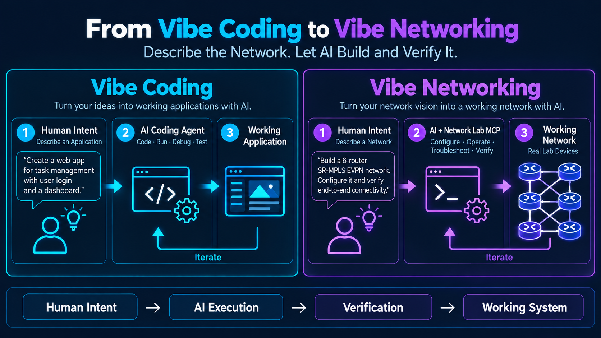
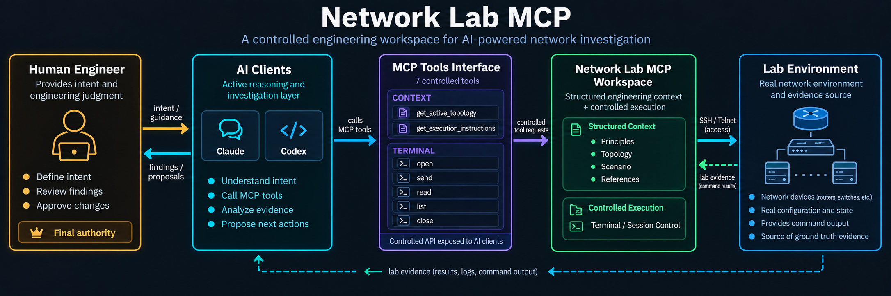
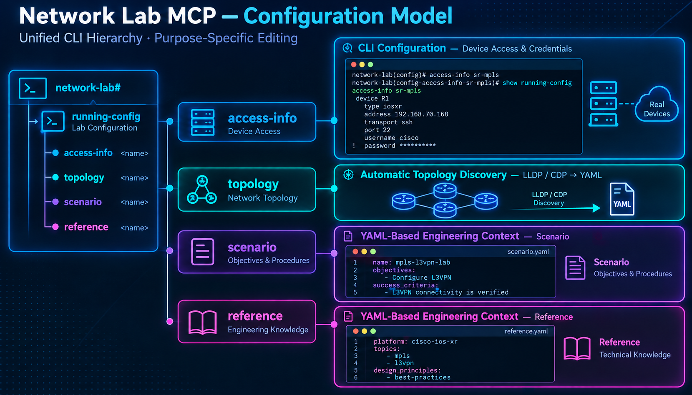

# Network Lab MCP

**An AI Network Engineer Workspace for real network labs.**

**Describe the network. Let AI investigate, build, troubleshoot, and verify it — while you remain in control.**

Network Lab MCP connects an MCP-capable AI client to real network lab devices through a small, controlled tool interface. It supplies the AI with explicit engineering context and observable terminal sessions, so the AI can follow evidence, run commands, and work through complex lab investigations instead of relying on a rigid test script.

**The AI client does the reasoning; Network Lab MCP provides the context and access; the engineer retains authority over decisions and committed definitions.**

<p align="center">
  
</p>

[Watch the demo](https://youtu.be/ILkW7yuU1Y4) · [Why it exists](#why-network-lab-mcp) · [How it works](#how-it-works) · [Configuration model](#configuration-model) · [Quick Start](#quick-start) · [Documentation](#documentation)

## Why Network Lab MCP?

As a network engineer, I often want to investigate or validate something in a lab, but customer work, troubleshooting, meetings, and documentation limit the time available for hands-on verification.

What if AI could do the time-consuming investigation — inspect the topology, connect to the right devices, compare outputs, follow a problem, and return evidence — without taking away the engineer's visibility or judgment?

That is the motivation behind Network Lab MCP: **delegate the investigation, not the engineering responsibility.**

The project explores a concept I call **Vibe Networking**, inspired by Vibe Coding: express the network objective in natural language, let an AI agent plan and execute work in a real lab, inspect what actually happened, and iterate. It is a direction for AI-assisted engineering, **not a claim of unrestricted or fully autonomous production-network operation**.

## What you can do

- **Investigate and troubleshoot:** inspect live device state across a lab, correlate observations, and collect command evidence.
- **Discover and validate topology:** collect LLDP/CDP neighbors, review a topology candidate, and explicitly commit the definition.
- **Build and verify lab services:** give the AI engineering objectives and let it use real terminals to configure and test lab devices, subject to the AI client's permissions and human oversight.
- **Validate resilience and traffic:** observe planned failures, traffic behavior, protocol convergence, and service continuity using available lab instruments and evidence.
- **Reuse engineering knowledge:** guide repeated work with Scenarios and References rather than repeating every instruction from scratch.
- **Watch AI activity:** monitor terminal output live and inspect session transcripts instead of treating the AI as a black box.

Network Lab MCP is **not** a network-engineering reasoning model, a fixed test-script library, or a production network automation platform. An external AI client supplies the reasoning and decides which tool or command to use next.

## How it works

<p align="center">
  
</p>

1. **Human intent:** an engineer specifies the goal and the limits of the task.
2. **Engineering context:** Network Lab MCP exposes the selected topology, task instructions, principles, and applicable references — without revealing private access credentials.
3. **AI reasoning:** the AI client chooses the investigation steps and invokes MCP tools.
4. **Controlled execution:** Network Lab MCP connects to devices through managed SSH/Telnet terminal sessions, using private connection information internally.
5. **Evidence and review:** the AI analyzes device outputs and reports findings; the engineer can observe terminals and approves changes to managed definitions through the human CLI.

> **Safety boundary:** the candidate/commit model protects Network Lab MCP's *managed lab definitions and selections*. It does **not** automatically make device CLI commands read-only or require human approval before every command sent by an AI client. Configure client permissions and use an isolated lab accordingly.

### A deliberately small MCP interface

Network Lab MCP exposes exactly **seven MCP tools**:

| Tool | Purpose |
|---|---|
| `get_active_topology` | Read the currently selected logical topology |
| `get_execution_instructions` | Read selected task guidance and engineering context |
| `terminal_open` | Open a managed terminal by logical device ID |
| `terminal_send` | Send text to a managed device terminal |
| `terminal_read` | Read its output |
| `terminal_list` | Inspect managed terminal sessions |
| `terminal_close` | Close a managed terminal session |

The AI uses logical device names; it does not obtain private `access-info`. See the [MCP tool contract](docs/mcp_tools.md).

## Configuration Model

Network Lab MCP separates **what is selected**, **how to connect**, **what exists**, **what to accomplish**, and **what knowledge to reuse**.

<p align="center">
  
</p>

*Conceptual diagram: the running configuration selects definitions; it does not contain every definition's full content. The illustration's masked password is not a representation of local CLI password display behavior.*

| Component | Responsibility | AI visibility |
|---|---|---|
| `running-config` | Selects the active access-info, topology, scenario, and references | Indirect |
| `access-info` | Private management endpoints and authentication details | **Not exposed through MCP** |
| `topology` | Logical devices, interfaces, and connectivity | Yes |
| `scenario` | Objectives, task procedures, and verification criteria | Yes |
| `reference` | Reusable technical knowledge and operational guidance | Yes, when selected or inspected read-only |

`running-config` is a **selection model**, not the storage location for all definitions. Creating or changing a topology, Scenario, or Reference does not automatically select it. Selection changes become active after an explicit CLI `commit`.

**Scenario** describes *what the AI is trying to accomplish now*. **Reference** contains *knowledge that can help across many tasks*, such as SR-MPLS or EVPN guidance, platform-specific notes, or test-equipment procedures. **Principles** are separate, always-applied rules, not a substitute for task-specific scenarios or reusable references.

The AI may inspect a catalog of stored Scenarios and References, use the applicable knowledge, and propose new or refined definitions. It does not directly commit those definition changes. Engineers edit and commit them through the independent human CLI.

### Three complementary configuration workflows

- **CLI configuration:** use the IOS XR-style human CLI to manage access information, definitions, and active selections with candidate/commit behavior. `clear` discards uncommitted changes.
- **Topology discovery:** discover LLDP/CDP neighbor relationships from actual devices and review the resulting candidate before a separate definition commit and active selection.
- **YAML-based engineering context:** edit Topology, Scenario, and Reference definitions through the configured external editor (`$VISUAL`, then `$EDITOR`, then Vim). Access-info uses the structured CLI.

New installations start with the fictional `sample_lab` access-info and topology, the onboarding `getting_started` Scenario, and the supporting `cisco_platform_guidance` Reference. Existing local selections are not automatically rewritten.

See [Architecture](docs/architecture.md), [CLI reference](docs/cli_reference.md), and [Scenario / Reference format](docs/scenario_format.md).

## Demo

### Traffic Loss Validation with Network Lab MCP

The [video demonstration](https://youtu.be/ILkW7yuU1Y4) illustrates an AI-assisted workflow involving live terminal observation, a validation Scenario, traffic measurement, analysis, and reporting.

The demo is a concrete lab example, not a guarantee that every device, test instrument, or network design can be controlled without additional configuration.

## Quick Start

### Requirements

- Linux, Python **3.10+**, `tmux`, and an OpenSSH client
- A `telnet` client only if lab devices require Telnet
- An MCP-capable AI client, such as **Claude Code** or **Codex CLI**

macOS may work but is not formally validated. Native Windows is not supported; WSL2 is not formally validated.

### 1. Install from a local checkout

```bash
git clone https://github.com/CiscoDevNet/network-lab-mcp-community.git
cd network-lab-mcp
python3 -m venv .venv
source .venv/bin/activate
pip install -e .
```

This project currently uses a **local editable installation**; the repository-local `lab/` directory is part of its operational model. Non-editable wheel or package-index installation is not supported.

### 2. Initialize local selections

```bash
cp lab/settings.example.yaml lab/settings.yaml
```

The checked-in sample is fictional and uses documentation-only addresses. To connect to a real lab, create private connection definitions and select the appropriate definitions through the CLI. Never commit real credentials or sensitive lab details to a public repository.

### 3. Register the MCP server

Use the **absolute path** to the executable inside this repository's virtual environment, replacing `/path/to/network-lab-mcp` below.

**Claude Code** — user scope:

```bash
claude mcp add network-lab -s user -- \
  /path/to/network-lab-mcp/.venv/bin/network-lab-mcp
claude mcp list
```

**Codex CLI**:

```bash
codex mcp add network-lab -- \
  /path/to/network-lab-mcp/.venv/bin/network-lab-mcp
codex mcp list
```

For a local stdio server, Codex may show `Auth: Unsupported`; device authentication is handled privately by Network Lab MCP, not by MCP authentication. In the tested Codex environment, the following server setting was also needed in `~/.codex/config.toml`:

```toml
[mcp_servers.network-lab]
command = "/path/to/network-lab-mcp/.venv/bin/network-lab-mcp"
default_tools_approval_mode = "approve"
```

Restart Codex after changing its configuration. AI-client configuration and approval options may differ by client version.

### 4. Start the human CLI

```bash
./run_cli.sh
```

Useful first commands:

```text
help
help claude
show version
show running-config
configure
```

### 5. Start your AI client

The task workspace can be **outside** the Network Lab MCP repository:

```bash
cd ~/work/my-lab-task
claude
# or: codex
```

Start with a bounded task, such as reviewing the active topology and reporting what can be verified without changing device configuration.

> **Permissions:** keep the AI client's normal approval controls enabled, particularly for device configuration and destructive operations. Bypass/never-ask modes are appropriate only when explicitly chosen for a fully controlled, isolated lab; they bypass client-side confirmation and are not prerequisites for using Network Lab MCP.

## Example: discovering and selecting a topology

First, create a private access-info definition and select it as active through the human CLI. For example, you can start by copying the fictional template and changing it locally:

```bash
cp lab/access-info/sample_lab.yaml lab/access-info/my_lab.yaml
```

With `my_lab` already selected as the active access-info, a typical CLI flow is:

```text
network-lab# configure
network-lab(config)# discover topology
Discovering topology from access-info 'my_lab'...
...
Discovery complete.
...
network-lab(config-topology-my_lab)# show configuration
...
network-lab(config-topology-my_lab)# commit
Commit complete.
network-lab(config-topology-my_lab)# root
network-lab(config)# running-config
network-lab(config-running)# topology my_lab
network-lab(config-running)# commit
Commit complete.
```

The two commits serve different purposes: **the first saves the discovered topology definition; the second selects it as active**.

Discovery is intentionally conservative:

- `discover topology` collects LLDP/CDP evidence only; `discover topology l3` adds observed IPv4/VRF information.
- It **rebuilds** the topology candidate from the current observations instead of silently merging older links. Unobserved elements can therefore disappear **from the new candidate**. The committed definition remains untouched until `commit`.
- Missing or conflicting evidence, failures, and uncommitted manual edits cause Discovery to fail closed rather than guessing or overwriting edits.
- Discovery does not configure devices, enable LLDP/CDP, auto-commit, or auto-select a topology.
- `clear` discards uncommitted candidate changes and restores the committed state.

See [CLI reference](docs/cli_reference.md) for detailed discovery conditions and command syntax.

After the context is selected, a typical AI sequence uses:

```text
get_active_topology()
get_execution_instructions()
terminal_open(...)
terminal_send(...)
terminal_read(...)
...
```

## Observable terminals

Engineers can observe the same managed terminal activity used by the AI, read-only, from the human CLI:

```text
network-lab# terminal monitor R1
RP/0/RP0/CPU0:R1#show version
...
RP/0/RP0/CPU0:R1#
```

Monitoring does not inject commands into the observed session. It can follow managed and Discovery terminal sessions, including their lifecycle changes. Exit locally with `q`.

Terminal transcripts are stored at `logs/terminal/<device-id>/*.log`. They are **raw transcripts**, not guaranteed-redacted records; handle them as sensitive data. See [Terminal monitor](docs/cli_reference.md#terminal-monitor).

## Platform-aware engineering knowledge

The architecture is **vendor-neutral**, but the public examples and initial platform guidance focus on Cisco devices. The included `cisco_platform_guidance` Reference illustrates how reusable knowledge can be qualified by device family, software release, feature, and question type. It is selected by the sample configuration, not mandatory for all installations, and it does not fetch or validate documentation automatically.

Protocol theory may transfer across platforms, but command syntax, supported features, limitations, telemetry paths, and release-specific behavior require device-appropriate evidence. For example, telemetry paths should come from applicable YANG models, not guesses; the [Cisco YANG models repository](https://github.com/YangModels/yang/tree/main/vendor/cisco) is one possible reference source.

### Supported device types

| `device.type` | Platform | Topology Discovery |
|---|---|---|
| `iosxr` | Cisco IOS XR | LLDP + CDP |
| `iosxe` | Cisco IOS XE | LLDP + CDP |
| `ios` | Classic Cisco IOS | CDP |
| `nxos` | Cisco NX-OS | Not currently supported |
| `host` | Generic host / endpoint | Skipped |

A registered type does not imply that every platform capability, command, or discovery protocol is supported.

## Security and operational boundaries

See [SECURITY.md](SECURITY.md) for the complete trust model and vulnerability reporting guidance.

- **Private credentials:** no MCP tool exposes `access-info`. Terminal connections resolve credentials internally from the selected private definition.
- **Local CLI visibility:** `show configuration` and `show running-config` can display access-info passwords **in plaintext** for human lab use. Do not share that output.
- **Raw device output:** terminal results and logs are not universal secret-redaction mechanisms. Remote device echoes and output can contain sensitive information.
- **SSH/Telnet:** SSH key/agent and password authentication are supported; classic IOS-style Telnet authentication is lab-only because Telnet is unencrypted.
- **Jump hosts:** one OpenSSH ProxyJump hop is supported; multi-hop chains are not.
- **Change control:** candidate/commit applies to local definition editing. Sending a configuration command to a real device through a terminal is a separate operation governed by the AI client's permissions and your lab procedures.
- **Repository hygiene:** `.gitignore` excludes common local operational data but is not a substitute for reviewing every change before publishing.

## Current limitations

- Discovery supports IOS XR, IOS XE, and classic IOS, but not NX-OS.
- No SNMP, NETCONF, RESTCONF, or generic discovery-plugin framework.
- No automatic stale-link pruning **outside a Discovery run**; Discovery itself rebuilds the candidate from current observations.
- L3 enrichment records directly observed IPv4 address and VRF information, not an inferred routed topology.
- Editable checkout required; no standard non-editable/wheel installation.
- `access-info` is edited through structured CLI commands, not the external YAML editor.
- OpenSSH ProxyJump is limited to a single hop.
- Scenario/Reference schemas are intentionally flexible; some identifier classes do not yet protect against case-only collisions.
- Full cross-vendor operation and all forms of autonomous deployment are not claimed or validated.

## Project structure

```text
network-lab-mcp/
├── README.md
├── SECURITY.md
├── CONTRIBUTING.md
├── CODE_OF_CONDUCT.md
├── AGENTS.md
├── LICENSE
├── pyproject.toml
├── run_cli.sh
├── src/network_lab_mcp/     # MCP server, terminal, discovery, human CLI
├── lab/                     # Local selections, principles, definitions
│   ├── settings.example.yaml
│   ├── principles.yaml
│   ├── access-info/
│   ├── topologies/
│   ├── scenarios/
│   └── references/
├── docs/
│   ├── images/
│   │   ├── network-lab-mcp-concept.webp
│   │   ├── vibe-coding-vs-vibe-networking.webp
│   │   └── network-lab-mcp-configuration-model.webp
│   ├── architecture.md
│   ├── mcp_tools.md
│   ├── cli_reference.md
│   └── scenario_format.md
└── tests/
```

## Testing

Real-lab tests are opt-in and should be used only against approved lab infrastructure:

```bash
NETWORK_LAB_REAL_TESTS=1 pytest tests/test_real_lab_iosxr.py -v --tb=line
```

Avoid `--showlocals` when tests could access real credentials.

## Documentation

- [Architecture and configuration model](docs/architecture.md)
- [MCP tool contract](docs/mcp_tools.md)
- [Human CLI reference](docs/cli_reference.md)
- [Scenario and Reference format](docs/scenario_format.md)
- [Security policy](SECURITY.md)

## Contributing, feedback, and license

Issues, bug reports, and suggestions are welcome through [GitHub Issues](https://github.com/CiscoDevNet/network-lab-mcp-community/issues). See [CONTRIBUTING.md](CONTRIBUTING.md) for how to contribute and [CODE_OF_CONDUCT.md](CODE_OF_CONDUCT.md) for community standards. Report security issues as described in [SECURITY.md](SECURITY.md), not through public issues. Guidance for AI coding agents working on this repository is in [AGENTS.md](AGENTS.md).

Run `show version` in the human CLI to inspect the local version, release date, Git revision, platform, MCP SDK version, and license information.

Licensed under the **Apache License, Version 2.0** (SPDX: `Apache-2.0`). See [LICENSE](LICENSE).

License history: earlier revisions of this repository's history were published under the GNU General Public License v3.0. Those revisions are not relicensed retroactively by this change; the Apache License, Version 2.0 applies to the project going forward.
